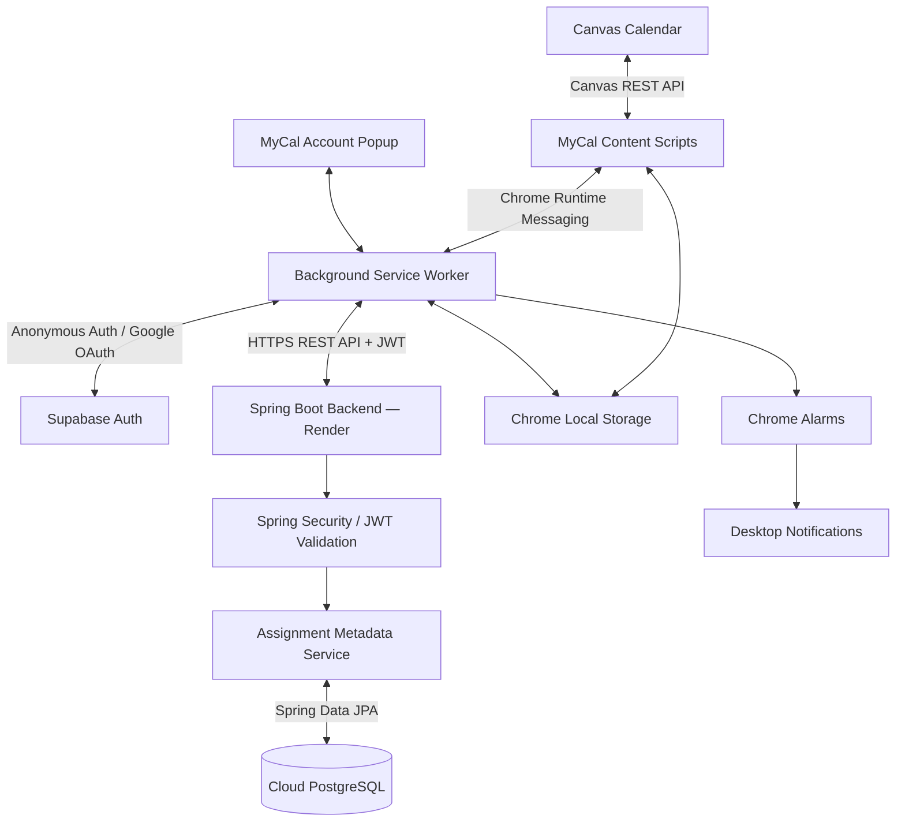
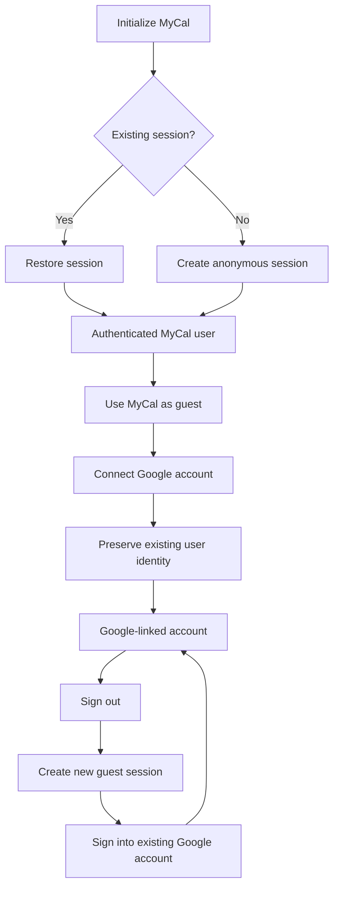

# MyCal — Canvas Calendar Power Tool

**Plan beyond the due date.**

MyCal is a Chrome extension that enhances the Canvas Calendar with personal planning and productivity tools, helping students turn official course deadlines into actionable plans without modifying Canvas data.

Developed as part of the **University of Florida WiCSE Shadowing Program**, with technical guidance and mentorship from a software engineer at **American Express**.


> **Status:** Functional, cloud-hosted MVP (November 2026). Built and tested against the University of Florida's Canvas instance. Available for manual installation as an unpacked Chrome extension.

## Table of Contents

- [Why MyCal?](#why-mycal)
- [Features](#features)
- [Technology Stack](#technology-stack)
- [System Architecture](#system-architecture)
- [Authentication and Security](#authentication-and-security)
- [Data Storage](#data-storage)
- [Getting Started](#getting-started)
- [Backend API](#backend-api)
- [Local Development](#local-development)
- [Repository Structure](#repository-structure)
- [Testing and Validation](#testing-and-validation)
- [Development Journey](#development-journey)
- [Roadmap](#roadmap)
- [Known Limitations](#known-limitations)
- [Acknowledgments](#acknowledgments)

## Why MyCal?

Canvas Calendar is useful for viewing course assignments and official deadlines, but a due date alone does not tell students **how important an assignment is, how long it might take, or how they should organize their workload**.

MyCal addresses this gap by adding a personal planning layer directly to the existing Canvas Calendar, reducing the need to switch between Canvas and external productivity applications.

The application follows two core principles:

- **Canvas remains the source of truth** for courses, assignments, and official deadlines.
- **MyCal owns the personal planning layer**, including priorities, estimated effort, notes, tasks, and reminders.

MyCal is designed to complement Canvas rather than replace it.

## Features

### Assignment Planning

- **Priority levels:** Mark assignments as Low, Medium, or High priority, with visual indicators directly on the calendar.
- **Estimated effort:** Estimate the time required for individual assignments in minutes or hours.
- **Personal notes:** Record study plans, assignment details, and other personal information.
- **Inline editor:** Access assignment planning tools directly from Canvas Calendar entries.
- **Workload summary:** Review upcoming assignments, priorities, and estimated workload over the next seven days.
- **Cloud persistence:** Save assignment planning metadata to a cloud-hosted PostgreSQL database.

### Personal Organization

- **Personal tasks:** Create, edit, complete, and delete personal to-dos with optional due dates, priorities, and estimated effort.
- **Calendar controls:** Manage calendar visibility through a more compact calendar selection interface.
- **Appearance customization:** Choose among Forest, Ocean, Lavender, Rose, and Amber accent themes.

### Desktop Reminders

- **Individual assignment reminders:** Schedule reminders for 9 AM on the due date, 9 AM the day before, one hour before the deadline, or a custom date and time.
- **Chrome notifications:** Receive desktop notifications through Chrome's alarms and notifications APIs.
- **Assignment navigation:** Open the corresponding Canvas assignment by clicking its notification.
- **Demo mode:** Schedule a test notification approximately one minute later.

### Account Management

- **Guest mode:** Start using MyCal automatically without creating a separate account.
- **Google account linking:** Connect an existing guest account to Google while preserving saved assignment planning metadata.
- **Google sign-in:** Recover previously saved assignment planning data through a linked Google account.
- **Sign-out:** Return to a new guest session without deleting previously saved Google-linked data.
- **Session persistence:** Maintain authentication across browser sessions.
- **User data isolation:** Keep each authenticated user's assignment metadata separate.

## Technology Stack

| Layer | Technologies |
| --- | --- |
| Frontend | JavaScript, HTML, CSS |
| Browser Extension | Chrome Extension Manifest V3 |
| Canvas Integration | Canvas REST API |
| Browser APIs | Chrome Storage, Alarms, Notifications, Identity |
| Backend | Java 21, Spring Boot |
| Data Access | Spring Data JPA, Hibernate |
| Security | Spring Security, JWT Authentication |
| Authentication | Supabase Auth, Google OAuth 2.0, PKCE |
| Database | PostgreSQL |
| Build Tools | Maven, npm, esbuild |
| Containerization | Docker |
| Cloud Deployment | Render |
| Version Control | Git, GitHub |
| Development | VS Code |

## System Architecture

MyCal uses a layered architecture that separates Canvas integration, browser functionality, authentication, backend business logic, and persistent storage.



### Architecture Overview

1. **Canvas integration:** Content scripts retrieve course and assignment information using the student's existing authenticated Canvas session.

2. **Extension interface:** MyCal injects planning controls, calendar indicators, workload summaries, and personal organization tools into Canvas Calendar.

3. **Background service worker:** Coordinates authentication, backend communication, reminder scheduling, and Chrome extension messaging.

4. **Authentication:** Supabase manages anonymous sessions, Google identity linking, OAuth sign-in, and access tokens.

5. **Backend:** Spring Boot exposes authenticated REST endpoints for retrieving and updating assignment planning metadata.

6. **Database:** PostgreSQL provides persistent, user-specific storage for assignment planning metadata.

### Production Deployment

| Component | Deployment |
| --- | --- |
| Chrome Extension | Manual installation from GitHub |
| Spring Boot Backend | Render Web Service |
| PostgreSQL | Render Managed PostgreSQL |
| Authentication | Supabase |
| Backend Packaging | Docker |

**Production backend:**

https://mycal-backend.onrender.com

**Health endpoint:**

https://mycal-backend.onrender.com/api/health

The extension communicates with the deployed backend over HTTPS. End users do not need to install or run a local backend or database.

## Authentication and Security

MyCal uses Supabase authentication to provide a low-friction account experience while maintaining secure, user-specific backend persistence.

### Anonymous Authentication

When MyCal is initialized, the extension restores an existing authentication session or creates a new anonymous Supabase session.

This allows students to begin using MyCal without completing a separate registration process.

Anonymous users receive a unique authenticated identity, allowing their assignment planning metadata to remain isolated from other users.

### Google Identity Linking

Guest users can connect their MyCal account to Google through the extension's account popup.

Identity linking preserves the existing Supabase user identity, allowing previously saved assignment planning metadata to remain associated with the same account.

Users can subsequently sign into their linked Google account to recover their saved assignment planning data.

### Authentication Flow



### Backend Security

- Backend assignment metadata endpoints require a valid Supabase-issued JWT.
- Spring Security validates authentication before granting access to protected resources.
- The backend derives the authenticated user's identity from the token rather than trusting a user ID supplied by the client.
- Assignment metadata is scoped to the authenticated user, Canvas course ID, and Canvas assignment ID.
- Unauthorized requests are rejected with HTTP `401 Unauthorized`.
- Database credentials are configured through environment variables rather than committed to the repository.

### Separation from Canvas Authentication

MyCal authentication is independent of Canvas authentication.

- Canvas authentication provides access to official course and assignment information.
- MyCal authentication provides access to personal planning metadata.
- Signing out of MyCal does not sign the user out of Canvas.
- MyCal does not require students to provide their Canvas passwords to the extension.

## Data Storage

MyCal separates official academic information, cloud-persisted planning metadata, and browser-local preferences.

| Data | Storage | Synchronization |
| --- | --- | --- |
| Canvas courses | Canvas API | Managed by Canvas |
| Canvas assignments and deadlines | Canvas API | Managed by Canvas |
| Assignment priorities | PostgreSQL | Account-based |
| Estimated assignment effort | PostgreSQL | Account-based |
| Assignment notes | PostgreSQL | Account-based |
| Personal tasks | Chrome local storage | Browser/profile-specific |
| Appearance preferences | Chrome local storage | Browser/profile-specific |
| Assignment reminders | Chrome local storage | Browser/profile-specific |
| Authentication session | Chrome local storage | Session-specific |
| Workload summary | Calculated in extension | Derived from available assignment data |

### Assignment Identity

MyCal identifies assignment planning records using the combination of:

- Authenticated MyCal user identity
- Canvas course ID
- Canvas assignment ID

This prevents assignment titles from being used as identifiers and ensures that different users can maintain independent planning metadata for the same Canvas assignment.

### Backend Availability

PostgreSQL is the source of truth for assignment priorities, estimated effort, and notes.

MyCal intentionally does not maintain a local fallback copy of assignment planning metadata. If the backend is unavailable, the extension reports a connection error instead of displaying potentially inconsistent local data.

Personal tasks, appearance preferences, and reminders remain browser-local features.

## Getting Started

### Prerequisites

- Google Chrome
- Access to the University of Florida's Canvas instance
- An active Canvas login
- Internet access for cloud authentication and backend persistence

**No local Java, Maven, PostgreSQL, or Node.js installation is required to use MyCal.**

### Option 1: Download from GitHub

1. Visit the [MyCal GitHub repository](https://github.com/florida-k/mycal).
2. Select **Code → Download ZIP**.
3. Extract the downloaded ZIP file.
4. Open Google Chrome and navigate to:

   ```text
   chrome://extensions
   ```

5. Enable **Developer mode**.
6. Select **Load unpacked**.
7. Choose the extracted folder containing `manifest.json`.
8. Open [UF Canvas Calendar](https://ufl.instructure.com/calendar) while signed into Canvas.
9. Select an assignment's MyCal edit control to begin planning.

### Option 2: Clone the Repository

```bash
git clone https://github.com/florida-k/mycal.git
cd mycal
```

Open `chrome://extensions`, enable Developer mode, and load the cloned repository as an unpacked extension.

### Using MyCal

1. Open Canvas Calendar.
2. Select an assignment's MyCal editor.
3. Set a priority level, estimated effort, or personal notes.
4. Save your changes.
5. Review upcoming assignments through the seven-day workload summary.
6. Optionally create personal tasks, customize the appearance, or schedule reminders.

MyCal automatically creates or restores a guest authentication session when needed.

### Connecting a Google Account

1. Open the MyCal extension popup from the Chrome toolbar.
2. Select **Connect Google account**.
3. Complete the Google authentication flow.
4. Confirm that the popup displays **Google connected**.

Existing users can select **Already connected? Sign in** to recover assignment planning metadata associated with their linked account.

To disconnect the current MyCal session, select **Sign out**. Previously saved Google-linked assignment metadata remains stored in the backend.

> Google OAuth redirect configuration may require additional setup for unpacked installations on other computers. Guest mode does not require Google account linking.

### Testing Desktop Reminders

1. Ensure Chrome notifications are permitted in your operating system's notification settings.
2. Open an assignment's MyCal editor.
3. Enable its reminder.
4. Select **Test in 1 minute**.
5. Save the assignment settings.
6. Keep Chrome running and wait for the notification.
7. Click the notification to open the corresponding Canvas assignment.

### Updating MyCal

For cloned installations:

```bash
git pull origin main
```

Then open `chrome://extensions`, reload MyCal, and refresh Canvas Calendar.

For ZIP installations, download the latest repository version and replace the extension files before reloading the extension.

## Backend API

The production Spring Boot API is available at:

```text
https://mycal-backend.onrender.com
```

### Endpoints

| Method | Endpoint | Authentication | Description |
| --- | --- | --- | --- |
| GET | `/api/health` | No | Check backend availability |
| GET | `/api/assignments/{courseId}/{assignmentId}` | Required | Retrieve assignment planning metadata |
| PUT | `/api/assignments/{courseId}/{assignmentId}` | Required | Create or update assignment planning metadata |

Protected endpoints require an authorization header:

```http
Authorization: Bearer <SUPABASE_ACCESS_TOKEN>
```

### Example Assignment Metadata

```json
{
  "priority": "High",
  "estimatedMinutes": 120,
  "notes": "Review lecture slides and complete practice problems."
}
```

### Health Check

```bash
curl https://mycal-backend.onrender.com/api/health
```

Expected response:

```text
Canvas Calendar backend is running
```

### Unauthorized Request Test

```bash
curl -i https://mycal-backend.onrender.com/api/assignments/542201/6666209
```

Expected response status:

```text
401 Unauthorized
```

This verifies that assignment metadata cannot be retrieved through an unauthenticated request.

## Local Development

The following instructions are intended for developers who want to modify or run MyCal's backend locally. They are not required for normal extension usage.

### Development Prerequisites

- Java 21
- PostgreSQL
- Node.js and npm
- Git
- Maven or the included Maven wrapper
- Supabase project configuration

### Backend Setup

Create a local PostgreSQL database:

```sql
CREATE DATABASE canvas_calendar;
```

Configure the database environment variables:

```bash
export DATABASE_URL="jdbc:postgresql://localhost:5432/canvas_calendar"
export DATABASE_USERNAME="your_postgres_username"
export DATABASE_PASSWORD="your_postgres_password"
```

Ensure the Spring Boot JWT issuer and JWK configuration correspond to the Supabase project used by the extension.

Start the backend:

```bash
cd backend
./mvnw spring-boot:run
```

Verify the backend:

```bash
curl http://localhost:8080/api/health
```

To connect the extension to a local backend, update the API base URL in `background.js` and the corresponding host permissions in `manifest.json`.

### Authentication Bundle

The Supabase authentication source is maintained in `auth-poc/` and bundled into `chrome-auth.bundle.js` at the repository root.

To rebuild the authentication bundle:

```bash
cd auth-poc
npm install

npx esbuild test-chrome-auth.js \
  --bundle \
  --format=esm \
  --platform=browser \
  --outfile=../chrome-auth.bundle.js

cd ..
```

Reload the extension through `chrome://extensions` after rebuilding.

### Docker Build

The backend includes a Dockerfile for containerized deployment.

```bash
cd backend
docker build -t mycal-backend .
```

The containerized backend requires valid database connection settings and authentication configuration.

### Security Considerations

Do not commit:

- Database passwords
- Supabase service-role or secret keys
- Google OAuth client secrets
- Access or refresh tokens
- Private environment configuration files

Only public client configuration intended for browser usage should be included in the extension.

## Repository Structure

```text
mycal/
├── manifest.json
├── content.js
├── background.js
├── chrome-auth.bundle.js
│
├── mycal-sidebar.js
├── mycal-sidebar.css
├── mycal-editor.css
├── mycal-tasks.js
├── mycal-tasks.css
├── mycal-theme.js
├── mycal-theme.css
├── mycal-reminders.css
│
├── popup.html
├── popup.js
├── popup.css
│
├── icons/
│   └── icon128.png
│
├── auth-poc/
│   ├── test-chrome-auth.js
│   ├── supabase-client.js
│   ├── chrome-storage.js
│   └── package.json
│
├── backend/
│   ├── src/
│   ├── pom.xml
│   ├── mvnw
│   ├── Dockerfile
│   └── .dockerignore
│
└── README.md
```

The extension files are maintained at the repository root, while the Spring Boot application and authentication source are organized into separate directories.

## Testing and Validation

MyCal has undergone iterative manual testing throughout development, including local integration testing and production deployment verification.

| Test Scenario | Result |
| --- | --- |
| Canvas course and assignment retrieval | Passed |
| Assignment metadata creation and retrieval | Passed |
| Assignment metadata persistence after refresh | Passed |
| Seven-day workload summary | Passed |
| Personal task creation and management | Passed |
| Appearance preference persistence | Passed |
| Chrome desktop notifications | Passed |
| Anonymous authentication | Passed |
| Authentication session persistence | Passed |
| Google identity linking — authentication proof of concept | Passed |
| Google sign-in through account popup | Passed |
| Google sign-out through account popup | Passed |
| Authentication token refresh | Passed |
| Multi-user assignment metadata isolation | Passed |
| Cross-profile account recovery | Passed |
| Production backend health check | Passed |
| Unauthorized API request rejection | Passed |
| Production database persistence | Passed |

Testing was primarily performed using separate Chrome profiles, Canvas assignments, browser developer tools, and direct API requests.

Separate Chrome profiles were used to verify that different authenticated MyCal users could maintain independent planning metadata for the same Canvas assignment and recover Google-linked metadata after signing in.

Broader automated testing, fresh-installation testing on additional devices, and verification across other Canvas institutions remain future validation opportunities.

## Development Journey

### September 2026 — Project Planning and Initial Development

- Identified limitations in the existing Canvas Calendar planning experience.
- Defined project requirements, user workflows, and the initial architecture.
- Established the Chrome extension and Canvas API integration.
- Developed initial assignment planning functionality.

### October 2026 — MVP and Backend Integration

- Implemented assignment priorities, estimated effort, and personal notes.
- Added calendar indicators and seven-day workload summaries.
- Developed the Spring Boot REST API and PostgreSQL persistence layer.
- Demonstrated the working frontend-to-backend integration during the midterm presentation.
- Introduced personal tasks, appearance customization, and desktop reminders.

### November 2026 — Authentication, Security, and Deployment

- Transitioned from a single-user data model to authenticated, user-specific persistence.
- Integrated Supabase anonymous authentication and session management.
- Implemented Google OAuth identity linking and account recovery.
- Protected backend endpoints using Spring Security and JWT validation.
- Verified multi-user data isolation and token refresh.
- Removed the local assignment metadata fallback to maintain a consistent source of truth.
- Containerized the Spring Boot backend using Docker.
- Deployed the backend and PostgreSQL database to Render.
- Connected the Chrome extension to the production HTTPS API.
- Implemented the Google account management interface with linking, sign-in, and sign-out.
- Verified production persistence and cross-profile account recovery.

The project evolved from a browser-based planning prototype into an authenticated, cloud-hosted, multi-user application.

## Roadmap

### Completed

- [x] Canvas course and assignment retrieval
- [x] Assignment priority, estimated effort, and notes
- [x] Inline assignment planning editor
- [x] Calendar priority indicators
- [x] Seven-day workload summary
- [x] Spring Boot REST API
- [x] PostgreSQL assignment metadata persistence
- [x] Personal tasks with local persistence
- [x] Accent theme customization
- [x] Individual desktop assignment reminders
- [x] Multi-user data model
- [x] Supabase anonymous authentication
- [x] Google identity linking
- [x] Authentication session persistence and token refresh
- [x] JWT-protected backend endpoints
- [x] User-specific assignment metadata isolation
- [x] Google account management interface
- [x] Google sign-in and sign-out
- [x] Docker containerization
- [x] Cloud backend and database deployment
- [x] Production extension-to-backend integration
- [x] Cross-profile account recovery

### Future Improvements

- [ ] Publish MyCal to the Chrome Web Store.
- [ ] Expand support to additional Canvas institutions.
- [ ] Synchronize personal tasks, reminders, and appearance preferences across devices.
- [ ] Automatically reconcile reminders when Canvas assignment deadlines change.
- [ ] Expand automated unit, integration, and end-to-end testing.
- [ ] Improve accessibility and responsive behavior.
- [ ] Expand task organization with categories and subtasks.
- [ ] Further modularize the extension source code.
- [ ] Improve production monitoring and hosting reliability.
- [ ] Establish stable OAuth redirect configuration for distributed installations.

## Known Limitations

### Canvas Compatibility

MyCal currently targets the University of Florida's Canvas instance:

```text
https://ufl.instructure.com/*
```

Supporting other institutions requires updating the extension's host configuration and validating compatibility with their Canvas environments.

### Cloud Hosting

The backend and database currently use Render's free-tier hosting.

- The backend may enter an idle state, resulting in slower initial requests while the service restarts.
- The free PostgreSQL database is subject to expiration and hosting-plan limitations.
- Continued long-term availability requires maintaining or upgrading the hosting infrastructure.

### Local Features

Personal tasks, appearance preferences, and reminders are currently stored locally in Chrome and are not synchronized across devices or isolated by MyCal account.

Signing out of MyCal changes the authenticated account used for cloud assignment metadata but does not clear these browser-local features.

### Desktop Notifications

Chrome must be running for dependable notification delivery, and operating system notification permissions must allow Chrome alerts.

Changes to an instructor's assignment deadline do not currently reschedule an existing MyCal reminder automatically.

### Account Recovery

Anonymous guest sessions are tied to the extension's locally stored authentication session.

Users are encouraged to link a Google account before clearing extension data or moving to another device.

Assignment metadata saved under a guest account is not automatically merged when signing into a different existing Google-linked account.

Google OAuth recovery has been verified across Chrome profiles in the development environment. Additional OAuth redirect configuration and testing may be required for installations on other computers.

### Distribution

MyCal is currently distributed as an unpacked Chrome extension through GitHub and has not been published to the Chrome Web Store.

## Project Disclaimer

MyCal is an independent student-developed project created as part of an educational shadowing program.

It is not an official product of American Express, the University of Florida, or Instructure.

MyCal supplements the existing Canvas Calendar experience without modifying official course assignments or academic deadlines.

## Acknowledgments

Developed as part of the **University of Florida Women in Computer Science and Engineering (WiCSE) Shadowing Program** during Fall 2026.

Special thanks to my mentor at **American Express** for providing technical guidance, architectural feedback, and support throughout the development process.

The project provided an opportunity to explore full-stack software engineering, browser extension development, REST API design, relational databases, authentication, application security, and cloud deployment.

---

**MyCal — Plan beyond the due date.**