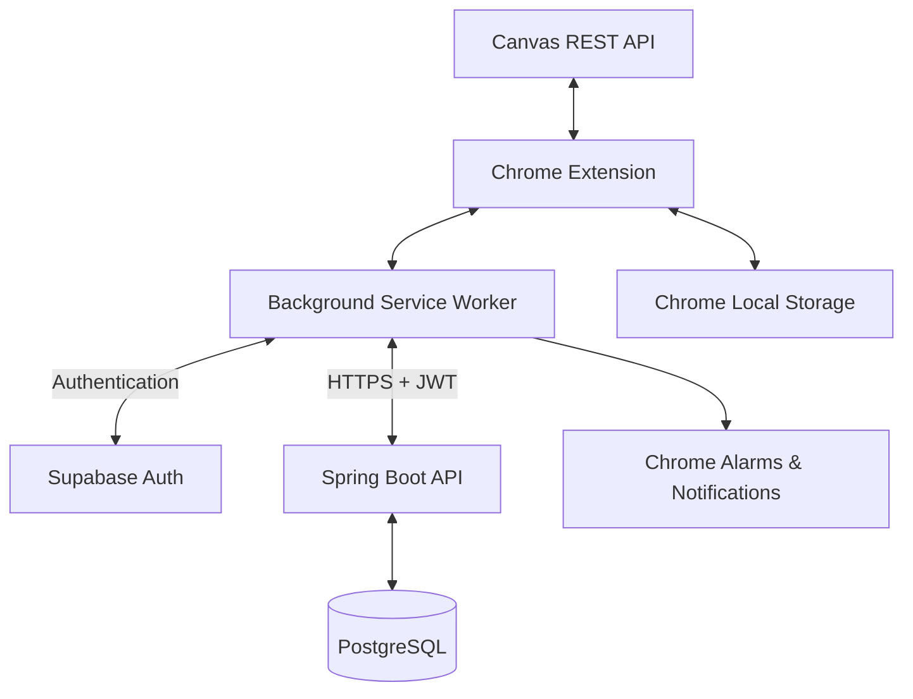

# MyCal — Canvas Calendar Power Tool

**Plan beyond the due date.**

MyCal is a Chrome extension that enhances Canvas Calendar
with personal planning and productivity tools, helping
students turn academic deadlines into actionable plans.

Developed through the **University of Florida WiCSE
Shadowing Program**, with mentorship from a software
engineer at **American Express**.

> **Status:** Functional, cloud-hosted MVP — November 2026.

## Overview

Canvas Calendar shows students when assignments are due,
but not how important they are, how long they might take,
or how to organize their workload.

MyCal adds a personal planning layer directly to Canvas
Calendar without modifying official Canvas data.

## Features

### Assignment Planning
- Low, Medium, and High priority levels with calendar indicators
- Estimated effort in minutes or hours
- Personal assignment notes
- Inline assignment planning editor
- Seven-day workload summary

### Personal Organization
- Personal task management
- Calendar visibility controls
- Five customizable accent themes
- Individual assignment reminders and desktop notifications

### Authentication and Cloud Persistence
- Automatic guest authentication without a separate login
- Google account linking, sign-in, and sign-out
- Persistent authentication sessions and token refresh
- User-specific assignment metadata
- Account recovery through Google sign-in
- JWT-protected backend endpoints

## Tech Stack

| Layer | Technologies |
| --- | --- |
| Frontend | JavaScript, HTML, CSS |
| Browser Extension | Chrome Manifest V3, Chrome Extension APIs |
| Canvas Integration | Canvas REST API |
| Backend | Java 21, Spring Boot, Spring Data JPA |
| Security | Spring Security, JWT |
| Authentication | Supabase Auth, Google OAuth 2.0, PKCE |
| Database | PostgreSQL |
| Build Tools | Maven, npm, esbuild |
| Deployment | Docker, Render |
| Version Control | Git, GitHub |

## Architecture

MyCal retrieves official course and assignment information
through the student's existing Canvas session. Supabase
provides independent MyCal authentication, while Spring Boot
validates JWTs and manages user-specific assignment metadata
in PostgreSQL.

| Cloud Storage | Local Chrome Storage |
| --- | --- |
| Assignment priorities | Personal tasks |
| Estimated effort | Appearance preferences |
| Assignment notes | Reminders |

The backend and PostgreSQL database are deployed on Render.
Assignment metadata is stored exclusively in the backend
to maintain a consistent source of truth.

## Installation

No local backend, database, or additional development
tools are required.

1. Download this repository using **Code → Download ZIP**.
2. Extract the downloaded folder.
3. Open `chrome://extensions` in Google Chrome.
4. Enable **Developer mode**.
5. Select **Load unpacked**.
6. Choose the folder containing `manifest.json`.
7. Open [UF Canvas Calendar](https://ufl.instructure.com/calendar)
   while signed into Canvas.

MyCal automatically creates a guest session. Open the
extension popup to optionally connect a Google account
and preserve access to your cloud-saved planning data.

## Deployment

- **Backend:** Spring Boot hosted on Render
- **Database:** Render PostgreSQL
- **Authentication:** Supabase
- **Containerization:** Docker

Production API: https://mycal-backend.onrender.com

Health check: https://mycal-backend.onrender.com/api/health

## Testing and Validation

The application has been manually tested for:

- Canvas API integration and assignment metadata persistence
- Anonymous authentication and session persistence
- Google identity linking, sign-in, and sign-out
- Authentication token refresh
- Multi-user data isolation across Chrome profiles
- Cross-profile account recovery
- Unauthorized API request rejection
- Desktop notification delivery
- Production backend and database connectivity

## Limitations and Future Improvements

- Currently supports the University of Florida's Canvas instance.
- Distributed as an unpacked extension, not yet published
  to the Chrome Web Store.
- Personal tasks, themes, and reminders remain browser-local
  and are not isolated by MyCal account.
- Render's free-tier hosting may introduce cold-start delays
  and database expiration.
- Google OAuth configuration may require additional setup
  for installations on other computers.
- Broader automated testing and cross-device validation
  remain future improvements.

Future development may include Chrome Web Store publication,
support for additional Canvas institutions, synchronization
of local features, and improved production reliability.

## Acknowledgments

Developed during Fall 2026 as part of the **University of
Florida Women in Computer Science and Engineering (WiCSE)
Shadowing Program**.

Special thanks to my mentor at **American Express** for
providing technical guidance, architectural feedback, and
support throughout the project.

MyCal is an independent student project and is not an
official product of American Express or Instructure.

---

**MyCal — Plan beyond the due date.**